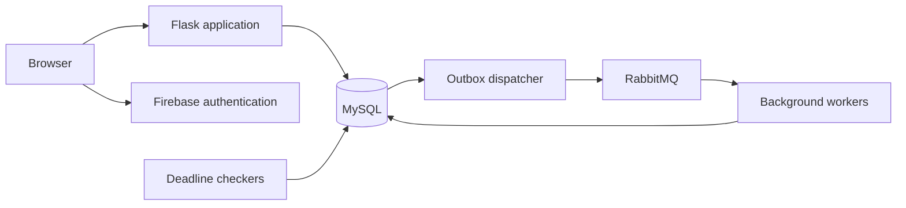
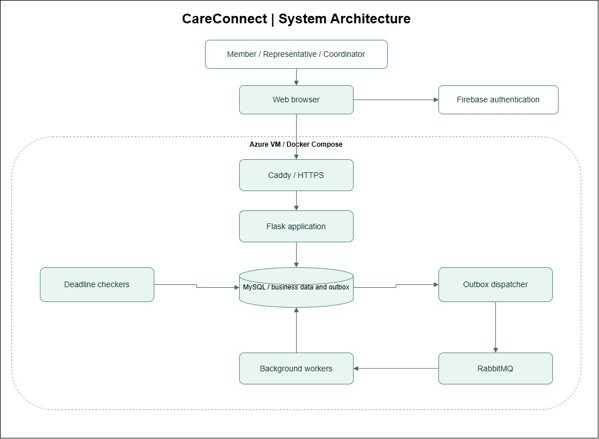

# System architecture

CareConnect uses a web application with separate background workers.

| Component | Responsibility |
|---|---|
| Frontend | Forms, dashboards and request tracking |
| Flask | Validates requests, checks permissions and handles business actions |
| Firebase | Verifies user identity |
| MySQL | Stores users, organizations, requests, referrals and events |
| Outbox dispatcher | Publishes saved events to RabbitMQ |
| Workers | Handle matching, notifications, deadlines and feedback |
| Deadline checkers | Find expired response and attendance deadlines |

The hosted version runs in Docker on Azure. Caddy provides HTTPS. The database and message broker are not exposed directly to the internet.

See [event architecture](EVENT_DRIVEN_ARCHITECTURE.md) for the seven implemented events.

## System Architecture Diagram

[Editable Draw.io Diagram](architecture/SYSTEM_ARCHITECTURE.drawio)
