# Final logical database mapping

The current baselines define 20 domain tables; migration 001 adds event_outbox,
active-slot/capacity/notification guards. Firebase UID/nullable password support
is already in both baselines and the live database. Migration 002 only upgrades
older users tables; never apply both Firebase migration copies.

This source-derived supplement is the current diagram for submission. The four
original ER module JPEGs, older 20-table/33-FK logical JPEG and normalization PDF
are preserved as historical teammate artifacts. This mapping includes 21 relations
and 34 declared FK edges. Nullable/conditional unique keys and functional
dependencies are explained in [the normalization report](../testing/NORMALIZATION_REPORT.md).

```mermaid
erDiagram
    attendance_records {
        int attendance_id PK
        int request_id FK
        int referral_id FK
        int attended_by_representative_id FK
    }
    event_outbox {
        string event_id PK
        int request_id FK
        string deduplication_key
        string event_type
        json payload
        datetime published_at
    }
    feedback {
        int feedback_id PK
        int request_id FK
        int member_id FK
        int organization_id FK
    }
    member_profiles {
        int profile_id PK
        int user_id FK
    }
    notifications {
        int notification_id PK
        int user_id FK
        int related_request_id FK
        string deduplication_key
    }
    organization_applications {
        int application_id PK
        int organization_id FK
        int submitted_by_user_id FK
        int reviewed_by_user_id FK
    }
    organization_availability {
        int availability_id PK
        int organization_service_id FK
        int recorded_by_user_id FK
    }
    organization_representatives {
        int representative_id PK
        int user_id FK
        int organization_id FK
    }
    organization_services {
        int organization_service_id PK
        int organization_id FK
        int service_id FK
        int service_area_id FK
    }
    organizations {
        int organization_id PK
    }
    priority_levels {
        int priority_id PK
    }
    referral_status_history {
        int history_id PK
        int referral_id FK
        int changed_by_user_id FK
    }
    referrals {
        int referral_id PK
        int request_id FK
        int organization_id FK
        string status
        int active_slot
    }
    roles {
        int role_id PK
    }
    service_areas {
        int area_id PK
    }
    service_categories {
        int category_id PK
    }
    service_completions {
        int completion_id PK
        int request_id FK
        int referral_id FK
    }
    service_priority_support {
        int support_id PK
        int organization_service_id FK
        int priority_id FK
    }
    service_requests {
        int request_id PK
        int member_id FK
        int service_id FK
        int service_area_id FK
        int priority_id FK
    }
    services {
        int service_id PK
        int category_id FK
    }
    users {
        int user_id PK
        int role_id FK
        string email
        string firebase_uid
        string password_hash
    }
    service_requests ||--o| attendance_records : "request_id"
    referrals ||--o{ attendance_records : "referral_id"
    organization_representatives ||--o{ attendance_records : "attended_by_representative_id"
    service_requests ||--o{ event_outbox : "request_id"
    service_requests ||--o| feedback : "request_id"
    users ||--o{ feedback : "member_id"
    organizations ||--o{ feedback : "organization_id"
    users ||--o| member_profiles : "user_id"
    users ||--o{ notifications : "user_id"
    service_requests |o--o{ notifications : "related_request_id"
    organizations ||--o{ organization_applications : "organization_id"
    users ||--o{ organization_applications : "submitted_by_user_id"
    users |o--o{ organization_applications : "reviewed_by_user_id"
    organization_services ||--o{ organization_availability : "organization_service_id"
    users ||--o{ organization_availability : "recorded_by_user_id"
    users ||--o| organization_representatives : "user_id"
    organizations ||--o{ organization_representatives : "organization_id"
    organizations ||--o{ organization_services : "organization_id"
    services ||--o{ organization_services : "service_id"
    service_areas ||--o{ organization_services : "service_area_id"
    referrals ||--o{ referral_status_history : "referral_id"
    users |o--o{ referral_status_history : "changed_by_user_id"
    service_requests ||--o{ referrals : "request_id"
    organizations ||--o{ referrals : "organization_id"
    service_requests ||--o| service_completions : "request_id"
    referrals ||--o{ service_completions : "referral_id"
    organization_services ||--o{ service_priority_support : "organization_service_id"
    priority_levels ||--o{ service_priority_support : "priority_id"
    users ||--o{ service_requests : "member_id"
    services ||--o{ service_requests : "service_id"
    service_areas ||--o{ service_requests : "service_area_id"
    priority_levels ||--o{ service_requests : "priority_id"
    service_categories ||--o{ services : "category_id"
    roles ||--o{ users : "role_id"
```

Key migration details: users.firebase_uid is ASCII/ascii_bin nullable UNIQUE;
password_hash is nullable. Referrals have (request_id, attempt_number) uniqueness
and a generated conditional active_slot unique guard. Organization services have
bounded-capacity CHECK; notifications have conditional (user_id,deduplication_key)
uniqueness. Outbox event_id and business deduplication_key are unique, with a
request FK, pending index and nonnegative attempts CHECK.

The generated active_slot is a virtual expression, and the displayed outbox payload
is versioned JSON. These are operational projections/messages, not a formal claim
that every stored or displayed attribute is in 3NF.

The normalized schema removes the stored is_backup attribute and its index.
Presentation derives backup status from attempt_number > 1. Keys and FK
edges stay the same. The current live database passed migration 003, as verified by the owner. See the [migration runbook](REFERRAL_MIGRATION_RUNBOOK.md).
